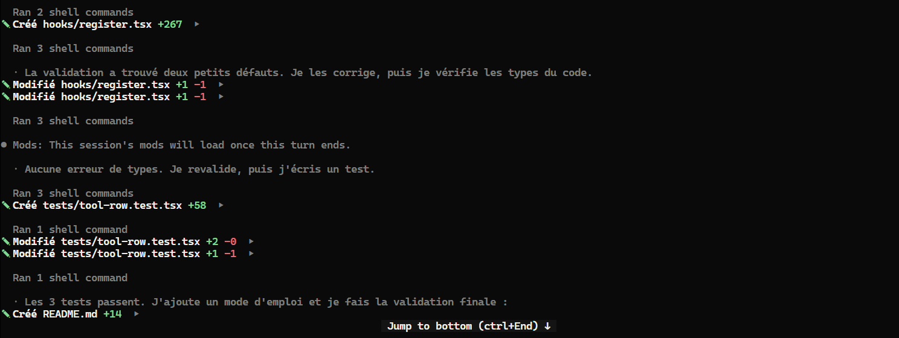

# Claude Code UI Friendly

A calmer, [OpenCode](https://opencode.ai)-style look for the Claude Code terminal. Tool calls shrink to one quiet line each, Claude's notes sit behind a thin bar, headings and list markers get color, and your terminal's background follows the theme you pick.



[](LICENSE)


## What's inside

This repository is a Claude Code plugin marketplace with two plugins. Install either one, or both.

| Plugin | What it does |
|---|---|
| [**ui-friendly**](plugins/ui-friendly) | One-line tool rows with the full detail on click and errors always unfolded. Three dark themes (OpenCode, Minimal Kiwi, Vesper). A terminal background that switches with the theme. |
| [**readable-layout-oc**](plugins/readable-layout-oc) | [Readable Layout](https://github.com/GarvitNangru/claude-code-mods/tree/main/mods/readable-layout) by Garvit Nangru, restyled: labeled boxes for you and Claude, notes behind a `┃` bar, violet headings, orange list markers. |

For a progress bar and a subagent panel, add [Agent Monitor](https://github.com/GarvitNangru/claude-code-mods/tree/main/mods/agent-monitor), also by Garvit Nangru. It works alongside both plugins.

## Requirements

- **Claude Code 2.1.312 or later.** Both plugins are mods, which use Claude Code's hooks API. That API is in early access and can change between releases. Run `claude --version` to check.
- **Fullscreen rendering** for click-to-expand: run `/tui fullscreen` once. Everything else also works in the classic renderer.
- **A true-color terminal.** Tested in Windows Terminal on Windows 11. Other terminals that support OSC color sequences, such as iTerm2, WezTerm, Ghostty or kitty, should work too, but haven't been tested.

## Quick start

At the Claude Code prompt:

```
/plugin install ui-friendly --marketplace mehdibml/claude-code-ui-friendly
/plugin install readable-layout-oc --marketplace mehdibml/claude-code-ui-friendly
```

Answer `y` when asked to add the marketplace, then pick the **user** scope so the plugins load in every session. They start working right away, with no restart.

Then pick a theme:

```
/theme
```

Choose **OpenCode**, **Minimal Kiwi** or **Vesper**, marked as from `ui-friendly`.

> **Already using the original Readable Layout?** Use one or the other, not both. Two layout mods would draw the same messages. Remove the original first with `/plugin uninstall readable-layout@garvit-mods`.

From a shell instead of the Claude Code prompt:

```
claude plugin install ui-friendly --marketplace mehdibml/claude-code-ui-friendly
claude plugin install readable-layout-oc --marketplace mehdibml/claude-code-ui-friendly
```

In the Claude desktop app, where `/plugin` does not run: click **+** next to the prompt box, then **Plugins**, **Add marketplace** with `mehdibml/claude-code-ui-friendly`, then **Add plugin**.

## What changes, at a glance

| | Stock Claude Code | With both plugins |
|---|---|---|
| A file edit | A header row, then the full diff inline | `✓ Modifié app.ts  +12 −3  ▸`, the diff one click away |
| A failed tool call | Full output | Full output (never folded) |
| Your message | `> fix the login bug` | Between rules labeled **You** |
| Claude's answer | Plain text after a bullet | Between rules labeled **Claude**, with colored headings, list markers and bold text |
| Claude's short notes | Same style as the answer | `┃ Checking the config first`, quiet and grey |
| End of a turn | A spinner line | A rule with the time taken |

The tool row labels are in French (`Modifié`, `Créé`, `Lu`, `en cours…`).

## Windows Terminal setup (optional)

UI Friendly already repaints the terminal background while Claude Code runs. To get the same colors in a dedicated **Claude Code** tab, add the files in [`windows-terminal/`](windows-terminal) to your Windows Terminal settings (**Settings** → **Open JSON file**):

1. Copy the three entries of [`schemes.json`](windows-terminal/schemes.json) into the `"schemes"` list.
2. Copy [`profile.json`](windows-terminal/profile.json) into `"profiles"` → `"list"`. It opens Claude Code directly, with the OpenCode colors and a little padding around the text.

Keep a **monospace** font such as Cascadia Mono, the Windows Terminal default. A terminal draws every character in a fixed-width cell, so proportional fonts like Arial come out unevenly spaced.

## Updating and removing

```
claude plugin update ui-friendly@ui-friendly
claude plugin update readable-layout-oc@ui-friendly
```

Then run `/reload-plugins` in any open session.

```
/plugin uninstall ui-friendly@ui-friendly
/plugin uninstall readable-layout-oc@ui-friendly
```

## Troubleshooting

| Symptom | Fix |
|---|---|
| Clicking a tool row does nothing | Turn on fullscreen rendering with `/tui fullscreen`. In iTerm2, also enable **Settings → Profiles → Terminal → Enable mouse reporting**. |
| The background doesn't change with the theme | Only the three UI Friendly themes repaint the background. Check that your terminal supports OSC 10/11 color sequences. |
| Messages are drawn twice, or the layout flickers between two styles | Two layout mods are installed. Keep `readable-layout-oc` or `readable-layout`, not both. |
| A plugin stops working after a Claude Code update | The mods API is in early access. Update the plugins, and [open an issue](https://github.com/mehdibml/claude-code-ui-friendly/issues) if the problem stays. |

## Development

Each plugin validates and tests with the Claude Code CLI:

```
claude plugin validate plugins/ui-friendly
claude plugin test plugins/ui-friendly
claude plugin validate plugins/readable-layout-oc
claude plugin test plugins/readable-layout-oc
```

To run a working copy in every session, list its folder in `CLAUDE_CODE_PLUGIN_DIRS` in the `env` block of `~/.claude/settings.json` (paths separated by `;` on Windows, `:` elsewhere). Claude Code reloads a mod each time its files are saved.

## Credits

- **[Garvit Nangru](https://github.com/GarvitNangru)** wrote [Readable Layout](https://github.com/GarvitNangru/claude-code-mods/tree/main/mods/readable-layout), on which `readable-layout-oc` is built, and the [Firelight](https://github.com/GarvitNangru/claude-code-mods/tree/main/skins/firelight) background-switching code that UI Friendly adapts. Both are MIT-licensed.
- The themes are color palettes modeled on the default theme of [OpenCode](https://opencode.ai), the [Minimal Kiwi](https://marketplace.visualstudio.com/items?itemName=pranjalkumar.minimal-kiwi) VS Code theme by Pranjal Kumar, and [Vesper](https://github.com/raunofreiberg/vesper) by Rauno Freiberg.

This project is not affiliated with Anthropic or OpenCode.

## License

[MIT](LICENSE). Third-party parts keep their own notices: [`plugins/readable-layout-oc/LICENSE`](plugins/readable-layout-oc/LICENSE) and [`plugins/ui-friendly/NOTICE.md`](plugins/ui-friendly/NOTICE.md).
